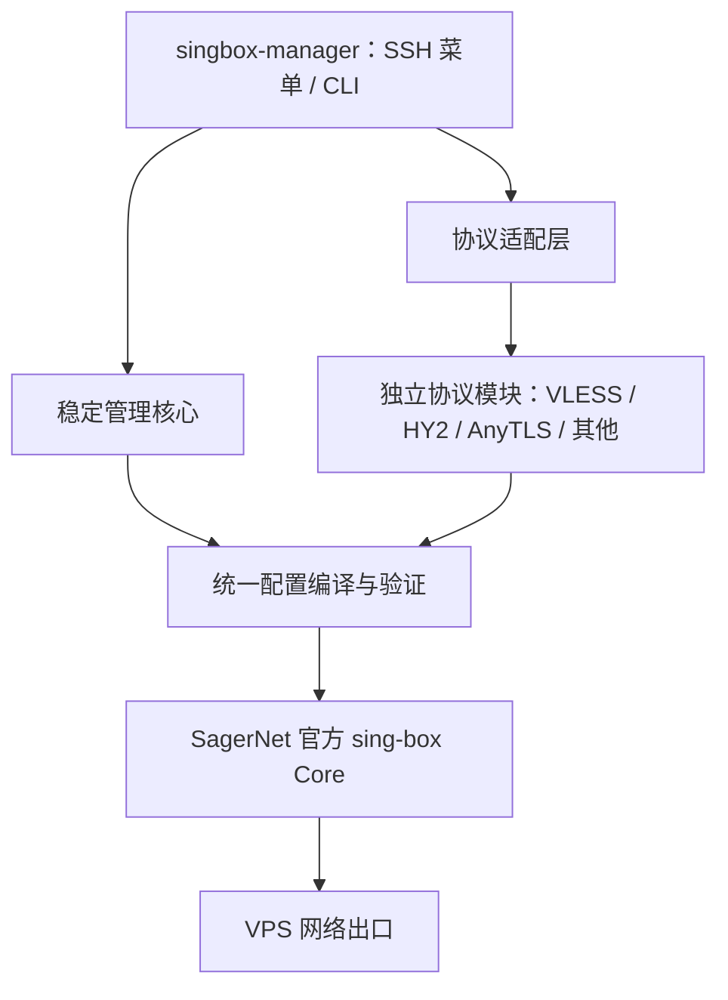

# v3.5.1 已实现的架构

按最终确认的结构，稳定管理核心与协议适配层分别处理管理和协议职责，统一在配置编译 / 官方验证后进入 sing-box Core。



## 文件职责

| 层 / 边界 | 实际代码 | 职责 |
|---|---|---|
| 入口 | `src/manager-core.sh` | SSH 菜单与 CLI 共用 action；输入与确认、节点流程 |
| 稳定核心 | `src/core/runtime.sh` | 官方版本目录、APT 基础单元、下载与校验、配套运行库 |
| 稳定核心 | `src/core/transactions.sh` | 快照、原子切换、pending、自动回滚、中断恢复 |
| 稳定核心 | `src/core/service.sh` | 仅控制 sing-box 的 systemd、端口 / 健康、诊断 |
| 稳定核心 | `src/sbm/core/` | 持久化、备份完整性、运行包标识、审计链 |
| 独立命令边界 | `src/sbm/entrypoint.py` | 恢复 / 存储 / 审计命令不导入协议模块 |
| 适配层 | `src/sbm/adapter_engine.py` | 注册模块、参数校验、版本 / 能力兼容、自检 |
| 协议模块 | `src/sbm/protocols/` | 九种协议各自的交互字段、入站、出站、URI、轮换和测试样例 |
| 统一编译验证 | `src/sbm/compiler.py` | 共享证书 / 外壳、调用协议入站、候选 Runtime 官方配置检查 |
| Runtime 桥接 | `src/sbm/runtime.py` | 有时限的 version / schema / check，解析真实构建能力 |

共享管理模型和兼容命令仍在 `src/sbm/engine.py`。配置 schema 保持 2；v2.4/v3.0 的模型、草稿和导出无需迁移。完整服务端 JSON 与导出文件维持原结果。没有调用 Xray、3X-UI 或其他代理核心管理服务。

## 模块契约 API v1

| 字段 / 方法 | 职责 |
|---|---|
| `kind / label / default_port` | 唯一标识、中文名称、默认端口 |
| `module_version / api_version` | 模块版本和接口版本 |
| `minimum_runtime / server_tags` | 完整模板最低 sing-box 版本和构建能力 |
| `networks / tls` | TCP/UDP、是否使用共享 ACME 证书 |
| `prompt / validate` | 只编辑草稿和验证协议参数 |
| `inbound / outbound / uri` | 返回服务端片段、客户端片段和导入链接 |
| `summary / rotate / netcheck` | 摘要、轮换、协议专属握手检查 |
| `sample` | 生成仅供离线自检的临时样例；不部署到真实节点 |

注册表显式导入内置模块，同时读取私有目录中的声明式 JSON 模块。内置模块校验唯一标识、API、版本、端口、网络和必需方法；JSON 模块只解析数据和占位符，不执行可写目录或远程 URL 中的代码。最低版本是模板要求，例如共享 ACME 提供者与 Hysteria2 BBR 字段要求 1.14；它并不表示协议在该版本才诞生。未来版本仍要通过官方 `check`，没有凭元数据假定所有未来版本都兼容。

普通新增协议优先从官方核心 Schema 自动发现、生成表单，无需填写 JSON、修改源码或重新构建。`official_schema.py` 负责内部引用解析、入站 / 出站清单、子版本配对及嵌套字段表单；仍由数据适配器输出配置，经统一编译和官方 check。涉及更复杂的非标准拓扑时，开发者也可创建派生 `Adapter` 的模块并补测试与构建。稳定核心无需添加该协议的判断分支。常规恢复和审计命令通过独立入口延迟加载，已测试在禁止导入协议模块时仍能执行备份校验原语。

## 实际配置提交路径

填写 / 加载草稿 → 参数验证 → 运行版本与构建能力预检 → DNS / 目标检查 → 统一编译 → 官方 `check` → 导出与端口预检 → 确认 → 再核对当前配置基准 → 完整快照与 pending → 仅停止 sing-box → 原子切换配置和完整运行包 → 官方 `check` / 启动 / 健康 / 端口归属 → 提交。

任何检查失败都不继续切换；事务内失败恢复配置、程序、随包运行库、导出和服务状态。恢复失败保留 pending。备份包含运行库的 SHA-256；运行目录标识涵盖主程序和配套库，避免同一主程序下不同运行库混用。

审计记录只允许固定事件、操作标识、结果与快照标识，拒绝任意负载；不记录密码、UUID、完整配置、客户端链接、输入或运行程序 stderr。日志使用 600 权限、flock、fsync、逐条哈希链；用于检测本地损坏，不防 root 重写完整历史。日志不随配置回滚而倒退。

## 构建和验证

```bash
python3 tools/build.py
bash tools/test.sh
```

构建器按固定顺序合并 Bash 核心，再内嵌模块化 Python zipapp。VPS 仅需单个发布脚本，不需要源码目录或 pip 包。源码不变、Python / zlib 工具链一致时构建摘要一致。开发源码中的 `# @include` 由构建器处理，日常直接运行生成的脚本。

```bash
sudo sbm protocols
sudo sbm compat --json
sudo sbm validate --json
sudo sbm module-test all --json
sudo sbm audit
```

模块自检只生成临时测试配置并执行官方检查，不启动监听。真实协议传输测试仍使用独立 `tests/live_roundtrip.py`，避免把配置可解析说成网络已连通。

## 无代码扩展与草稿

`src/sbm/protocols/declarative.py` 实现数据适配器，`profile_manager.py` 实现中文创建 / 导入 / 自检 / 移除流程。服务器加载 `/var/lib/singbox-manager/protocols/*.json`；节点用模块摘要绑定模板版本。损坏模板停止加载并显示管理错误，已有内置模块继续可用；存储和恢复入口仍不加载协议代码。模块的样例由表单类型自动生成，经当前官方 Core 检查；最低版本更高的模块可暂存，部署仍须兼容并通过检查。

菜单 22 管理未提交草稿，清理时先预览并确认，然后原子移动到私有归档。草稿在确认期间变化会拒绝清理。测试覆盖清理不改变线上配置、运行程序、导出与服务，原始用户草稿在升级验收后保留。

v3.5.1 增加菜单 29 / `paths` 的只读位置清单；草稿有归档放弃、永久删除当前草稿、永久清空归档三种独立操作。永久清理先预览和确认、再校验原文件 / 目录清单摘要；不写入配置、不控制服务、不额外归档。
